### Data Analytics | Business Intelligence | Data Strategy

**Master 2 Big Data, Analyse & Business Intelligence (BIDABI)**

*Relier les données, les enjeux métier et les décisions stratégiques.*

**Contact :** [canpekgoz.pro@gmail.com](mailto:canpekgoz.pro@gmail.com)

---

## Mon approche

Je combine une formation en **économie et gestion** avec des compétences en **Data Analytics, Business Intelligence et IA appliquée**. Je m'intéresse aux missions à l'interface des équipes métier, produit et technique.

| Comprendre | Construire | Décider |
|:---:|:---:|:---:|
| Diagnostic métier et processus | SQL, Python, Power BI, ML | KPI, recommandations et stratégie Data |

## Projet phare

### [ConsultAI 360 | Mission de conseil Data & IA](https://github.com/NacPKZ/ConsultAI-360)

**De la qualité des données aux décisions métier.** Simulation d'une mission complète de transformation Data pour **NexaRetail**, une entreprise fictive de distribution omnicanale.

Le projet couvre la génération de données, l'audit qualité, PostgreSQL, la modélisation Data Warehouse, dbt, Power BI, le Machine Learning sur DataCo, un assistant IA et une recommandation de transformation.

| Données | Analytics Engineering | Business Intelligence | Qualité logicielle |
|:---:|:---:|:---:|:---:|
| **4,1 M+** lignes RAW cumulées | **16** modèles dbt | **7** pages Power BI | **31** tests Python réussis |
| 4 scénarios | 37 tests dbt | Reporting décisionnel | Résultat historique documenté |

**Technologies :** Python, PostgreSQL, SQL, dbt, Power BI, DAX, scikit-learn, Streamlit, FastAPI, Ollama, Docker.

**Parcours :** `Diagnostic` → `Data Quality` → `Data Engineering` → `BI` → `Machine Learning` → `IA et stratégie`

Cas d'étude synthétique. Les résultats ML concernent DataCo, distinct de NexaRetail. Les ROI sont simulés.

## Autres réalisations

| Projet | Objectif et résultats | Outils |
|:---|:---|:---|
| [**Olist : Data Warehouse & SQL**](https://github.com/NacPKZ/Olist-Ecommerce-Data-Warehouse) | Modélisation et analyse de 99 441 commandes e-commerce | PostgreSQL, SQL, Data Quality |
| [**NovaTel : Customer Churn Analytics**](https://github.com/NacPKZ/NovaTel-Customer-Churn-Analytics) | Analyse de la fidélisation sur 7 043 clients | Power BI, DAX, KPI |
| [**ClassicModels : Sales Analytics**](https://github.com/NacPKZ/ClassicModels-Sales-Analytics) | Analyse des ventes et segmentation des clients | MySQL, Python, RFM |
| [**Google Trends : Analytics**](https://github.com/NacPKZ/Google-Trends-Analytics) | Exploration de tendances et comparaisons géographiques | Python, Streamlit |

**Explorer également :** [Word2Vec et NLP](https://github.com/NacPKZ/Word2Vec-NLP-Analysis) | [FHIR et Kafka](https://github.com/NacPKZ/FHIR-Streaming-Pipeline) | [Spotify et PySpark](https://github.com/NacPKZ/Spotify-PySpark-Analytics)

---

## Compétences et outils

| Domaine | Outils et méthodes |
|---|---|
| **Analyse et bases de données** | Python, pandas, SQL, PostgreSQL, MySQL |
| **Business Intelligence** | Power BI, Power Query, DAX, Excel, datavisualisation |
| **Data Engineering** | dbt, Docker, PySpark, Kafka, modélisation DW |
| **Machine Learning et IA** | scikit-learn, NLP, Word2Vec, Ollama, séries temporelles |
| **Conseil et produit** | Diagnostic métier, stratégie Data, KPI, recommandations, aide à la décision |

Technologies pratiquées à différents niveaux au cours de ma formation et de mes projets.

---

## Échanger autour d'un projet

Pour une opportunité de stage, une mission ou un échange autour de la Data :

### [canpekgoz.pro@gmail.com](mailto:canpekgoz.pro@gmail.com)

*Si le lien email ne s'ouvre pas, copiez l'adresse affichée ci-dessus dans votre messagerie.*

