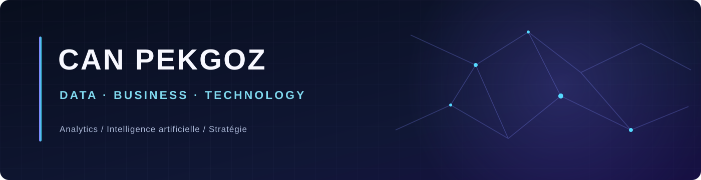

### Data Analytics · Business Intelligence · Stratégie & Produits numériques

**Master 2 Big Data, Analyse & Business Intelligence (BIDABI)**  
*J'associe analyse, technologie et compréhension métier pour transformer les données en décisions utiles.*

---

### Ce que je construis

| **Comprendre** | **Analyser** | **Décider** |
|:---:|:---:|:---:|
| Besoins métier, utilisateurs, processus | SQL, Python, BI, statistiques | KPI, recommandations, solutions numériques |

Mon profil associe **économie et gestion**, **Data & BI** et un intérêt pour **l'IA, les produits numériques et la transformation des organisations**. Je m'intéresse aux missions à l'interface entre équipes métier, produit et technique.

## Projets sélectionnés

| Projet | Réalisation | Technologies |
|:---|:---|:---|
| **[Olist · Data Warehouse & SQL](https://github.com/NacPKZ/Olist-Ecommerce-Data-Warehouse)** | Entrepôt de données e-commerce · 99 441 commandes | PostgreSQL · SQL · Data Quality |
| **[NovaTel · Customer Analytics](https://github.com/NacPKZ/NovaTel-Customer-Churn-Analytics)** | Analyse de la fidélisation · 7 043 clients | Power BI · DAX · KPI |
| **[ClassicModels · Sales Analytics](https://github.com/NacPKZ/ClassicModels-Sales-Analytics)** | Analyse des ventes et segmentation clients | MySQL · Python · RFM |
| **[Google Trends · Analytics](https://github.com/NacPKZ/Google-Trends-Analytics)** | Exploration des tendances et comparaison géographique | Python · Streamlit · Visualisation |

**Autres projets :** [Word2Vec · NLP](https://github.com/NacPKZ/Word2Vec-NLP-Analysis) · [FHIR · Streaming Kafka](https://github.com/NacPKZ/FHIR-Streaming-Pipeline) · [Spotify · PySpark](https://github.com/NacPKZ/Spotify-PySpark-Analytics)

---

## Compétences et outils

| Domaine | Outils et méthodes mobilisés |
|---|---|
| **Data & SQL** | Python · Pandas · PostgreSQL · MySQL · Analyse exploratoire |
| **Business Intelligence** | Power BI · DAX · Excel · KPI · Data Visualization |
| **Ingénierie des données** | Docker · Kafka · PySpark · Elasticsearch |
| **IA & analyses avancées** | NLP · Word2Vec · Machine Learning · Séries temporelles |
| **Business & produit** | Analyse métier · Indicateurs de performance · Aide à la décision |

Technologies pratiquées à des degrés différents au cours de ma formation et de mes projets.

---

### Échanger autour d'un projet, d'une opportunité ou d'une problématique Data

**[✉ canpekgoz.pro@gmail.com](mailto:canpekgoz.pro@gmail.com)**

[**Tous mes dépôts GitHub →**](https://github.com/NacPKZ?tab=repositories)

